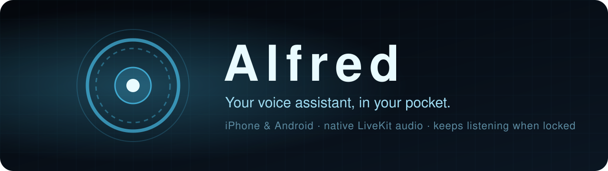
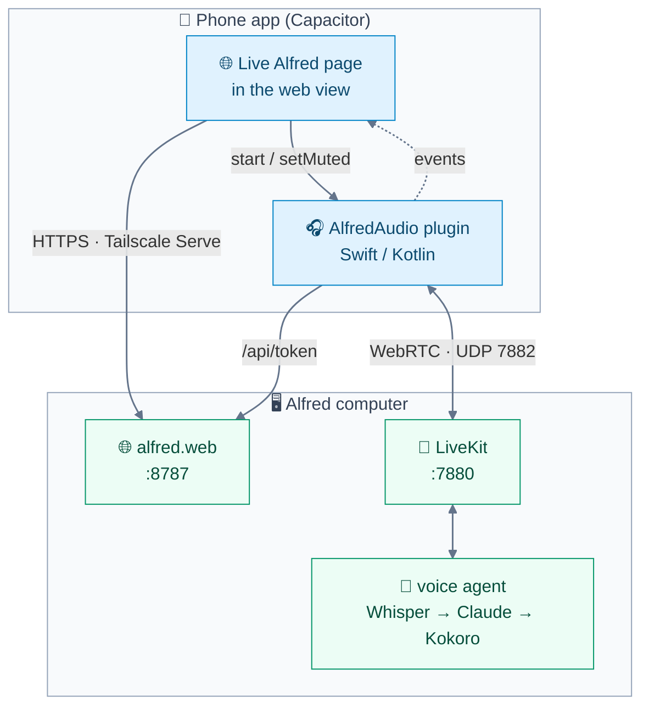

<div align="center">



<br>

[](package.json)
[](docs/ios.md)
[-3ddc84?style=flat-square&logo=android&logoColor=white)](docs/android.md)
[](docs/architecture.md)
[](packages/alfred-audio)
[](LICENSE)

**[Architecture](docs/architecture.md)** &nbsp;·&nbsp; **[Install](docs/install.md)** &nbsp;·&nbsp; **[Build & test](docs/build.md)** &nbsp;·&nbsp; **[Contributing](CONTRIBUTING.md)**

</div>

---

The phone app for **Alfred**, a personal voice assistant, built with **Capacitor**. It shows the **live Alfred web
page from the Alfred computer**, so changes to the page in the alfred repo show up **without rebuilding the app**. The voice
session runs in a native plugin, **AlfredAudio**, not in the web view, so it **keeps going with the screen
locked**.

<table>
<tr>
<td width="33%" valign="top">

### 🔒 Locked, still listening

The mic and Alfred's voice keep going with the screen off or another app in front.

</td>
<td width="33%" valign="top">

### 🎧 Hands-free control

Mute from the AirPods stem, a headset button, the lock screen or your watch.

</td>
<td width="33%" valign="top">

### 🔁 Comes back on its own

Phone calls, Siri, AirPods in and out, network drops: the session recovers.

</td>
</tr>
</table>

## ✨ Features

<table>
<tr>
<td width="50%" valign="top">

**🎤 Background mic**<br>
Keeps listening with the screen locked or another app in front, where a mobile browser or plain web view stops.

</td>
<td width="50%" valign="top">

**🔊 Background voice**<br>
Alfred's replies keep playing while the app is in the background.

</td>
</tr>
<tr>
<td width="50%" valign="top">

**🎧 Earphone button**<br>
Mutes and unmutes: the AirPods stem press on iOS 17+; on Android, wired or Bluetooth play/pause and the
notification's controls.

</td>
<td width="50%" valign="top">

**🏝️ Live Activity**<br>
Lock screen, Dynamic Island and Apple Watch show what Alfred is doing, with **Mute** and **Hang Up**. Android uses
an ongoing-call notification (a **Live Update** on Android 16).

</td>
</tr>
<tr>
<td width="50%" valign="top">

**🔔 Alerts with the app closed**<br>
Heartbeat alerts and background tasks arrive through **APNs** on iPhone and **Firebase Cloud Messaging** on Android.

</td>
<td width="50%" valign="top">

**📞 Call-aware**<br>
A phone call mutes the mic and silences Alfred, then offers both back when it ends.

</td>
</tr>
<tr>
<td width="50%" valign="top">

**🔇 Speaker off**<br>
Alfred answers only in the transcript, with no speech at all.

</td>
<td width="50%" valign="top">

**🎙️ Voice Isolation**<br>
On iPhone, the app opens Apple's Mic Mode picker until you choose Voice Isolation.

</td>
</tr>
</table>

## 🧭 How it fits together



- **The page stays the UI.** In the app it calls the plugin instead of opening its own LiveKit `Room`.
- **The plugin owns the connection**, because the web view's JavaScript is suspended in the background.
- **Nothing to patch on the computer:** Alfred already has the page's bridge, `/api/token` and the push endpoints.

Full story in **[🧱 Architecture](docs/architecture.md)**.

## 🚀 Quickstart

> [!IMPORTANT]
> Needs **Node 20+**, **Xcode 16.3+** on a Mac (for iOS and the LiveKit Swift package) and **Android Studio** with
> JDK 21, plus a running **[Alfred](https://github.com/anilkumarmeena/alfred)** and **Tailscale** on both the Alfred
> computer and the phone.

**1. Install and sync** — builds the plugin's TypeScript, then `npx cap sync` for both platforms:

```sh
npm install
npm run sync
```

**2. Serve Alfred on the tailnet** — run a current Alfred (`master`), then on its computer
([how](https://github.com/anilkumarmeena/alfred/blob/master/docs/mobile.md#-get-it-on-your-phone)):

```sh
make tailscale-serve
```

**3. Run it on the phone** — opens Xcode or Android Studio; pick the phone and press Run:

```sh
npm run ios        # or: npm run android
```

**4. Connect** — enter `https://<computer-name>.<tailnet>.ts.net`, then the passcode, and allow the microphone. Lock the
phone and keep talking.

> [!TIP]
> Signing, Developer Mode, Firebase and emulator notes are in **[📲 Install](docs/install.md)**.

## 🧰 Everyday commands

| | Command | What it does |
|:-:|---|---|
| 🔄 | `npm run sync` | Build the plugin, then `npx cap sync` |
| 🍎 | `npm run ios` | Open the iOS project in Xcode |
| 🤖 | `npm run android` | Open the Android project in Android Studio |
| 📐 | `npm run typecheck` | Typecheck the config, shell page and plugin API |
| 🧪 | `npm run test:ios` | Swift unit tests for the plugin's core |
| 🧪 | `npm run test:android` | The same logic in Kotlin, through Gradle |

The full list is in **[🔨 Build & test](docs/build.md#-tests)**.

## 📚 Documentation

<table>
<tr>
<td width="50%" valign="top">

**[🧱 Architecture](docs/architecture.md)**<br>
What the page does, what the app does, the server side, and the repo layout.

</td>
<td width="50%" valign="top">

**[🍎 iOS](docs/ios.md)**<br>
Audio session, AirPods mute, Live Activity, Voice Isolation, calls, reconnects, APNs.

</td>
</tr>
<tr>
<td width="50%" valign="top">

**[🤖 Android](docs/android.md)**<br>
Foreground service, call-style notification, headset buttons, calls, FCM.

</td>
<td width="50%" valign="top">

**[🔨 Build & test](docs/build.md)**<br>
Requirements, builds for both platforms, every test command, and project status.

</td>
</tr>
<tr>
<td width="50%" valign="top">

**[📲 Install](docs/install.md)**<br>
Put it on an iPhone or Android phone, set up Firebase, use an emulator.

</td>
<td width="50%" valign="top">

**[🤝 Contributing](CONTRIBUTING.md)**<br>
Setup, the checks a pull request must pass, and the code style.

</td>
</tr>
</table>

## 📊 Status

| Piece | State |
|---|---|
| TypeScript (plugin API, shell page) | ✅ typechecks |
| Swift core | ✅ **35 XCTest tests** pass |
| Kotlin core | ✅ **33 JUnit tests** pass through Gradle |
| Android app, plugin, service, activity | ✅ `assembleDebug` builds with no Kotlin warnings |
| Android on a phone | 🚧 **not run yet** |
| FCM end to end | 🚧 not tried: needs your Firebase project |

- Android hasn't run on a phone because the emulator couldn't start in the sandbox it was built in, and no phone
  was attached.
- The checklist for a first run on real phones is in [🔨 Build & test](docs/build.md#-things-to-check-on-a-phone).

## 📄 License

**[MIT](LICENSE)**. Contributions are welcome: start with **[🤝 Contributing](CONTRIBUTING.md)**.

---

<div align="center">


<sub>Alfred on your phone · the page from the computer, the audio native</sub>

</div>
