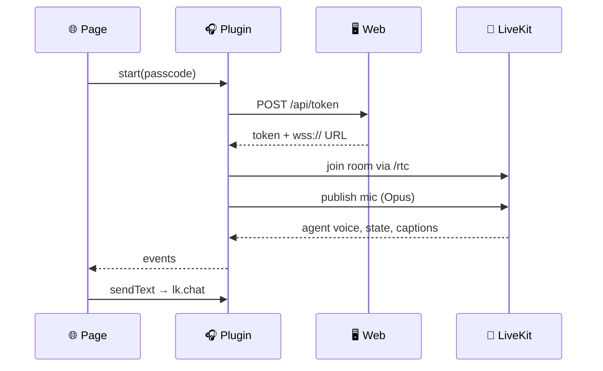

<div align="center">


# 🧱 Architecture

**How the app reuses the live JARVIS page while a native plugin owns the voice session.**

[🏠 Home](../README.md) · **🧱 Architecture** · [🍎 iOS](ios.md) · [🤖 Android](android.md) · [🔨 Build & test](build.md) · [📲 Install](install.md) · [🤝 Contributing](../CONTRIBUTING.md)

</div>

---

<details>
<summary><b>📑 On this page</b></summary>

- [The big picture](#-the-big-picture)
- [What the page does today](#-what-the-page-does-today)
- [What the app does](#-what-the-app-does)
- [Server side](#-server-side)
- [Loading the page](#-loading-the-page)
- [Layout](#-layout)
- [Changes to the generated projects](#-changes-to-the-generated-projects)

</details>

## 🧭 The big picture

```text
┌──────────── phone app (Capacitor) ─────────────┐            ┌─────── JARVIS computer ──────┐
│ WKWebView / Android WebView                    │  HTTPS     │ jarvis.web :8787             │
│   the live page, https://<computer>.ts.net ────┼──────────▶ │   /  /static/*  /api/token   │
│   (web/ in the jarvis repo, with lib/native.ts)│ Tailscale  │                              │
│        │ JarvisAudio.start / setMuted / events │  Serve     │ LiveKit :7880 (/rtc)         │
│        ▼                                       │            │   room jarvis-xxxx           │
│ JarvisAudio plugin (Swift / Kotlin)            │  WebRTC    │     ▲                        │
│   LiveKit native SDK: mic → Opus, agent voice ─┼──────────▶ │     └─ jarvis/voice/agent.py │
│   AVAudioSession / foreground service          │ UDP 7882   │        Whisper → Claude →    │
│   earphone button, interruptions, reconnects   │            │        Kokoro                │
└────────────────────────────────────────────────┘            └──────────────────────────────┘
```

How a session starts in the app. The agent (`jarvis/voice/agent.py`) sits in the LiveKit room, and `Web` is `jarvis.web`:



## 🌐 What the page does today

Read from the jarvis repo; **this repo doesn't change it.**

| | Piece | How it works |
|:-:|---|---|
| 🏠 | **Served by** | `jarvis/server.py` on `127.0.0.1:8787` |
| 🔐 | **Reached through** | Tailscale Serve only, at `https://<computer-name>.<tailnet>.ts.net` |
| 🎫 | **Session** | POSTs `{"passcode", "device"}` to `/api/token` |
| 📡 | **Room** | Joins with `livekit-client` at `wss://<same host>` |
| 🎤 | **Mic** | WebRTC Opus track, 48 kHz, media over UDP 7882 |
| 🔊 | **Voice** | Kokoro, spoken by `jarvis/voice/agent.py`, as the agent's audio track |
| 🧠 | **Agent state** | The agent's `lk.agent.state` attribute |
| 💬 | **Text** | Captions on `lk.transcription`, typed messages on `lk.chat` |

- Browsers on the JARVIS computer itself use `http://localhost:8787`.
- It **never streams audio over a plain WebSocket**. `/api/token` returns a LiveKit token for a fresh room and a URL,
  `wss://<same host>`, which Tailscale Serve proxies at `/rtc` to LiveKit on port 7880.
- The mic track has echo cancellation, noise suppression and auto gain on.
- **Web Push** uses a VAPID key from `/api/push/key`, a service worker at `/sw.js`, and `/api/push/subscribe`. It
  only works in the Home Screen web app over HTTPS.

> [!CAUTION]
> **The passcode is the only auth.** The page keeps it in `localStorage` and sends it with every `/api/*` call. Ten
> wrong ones in five minutes lock everyone out for a while.

## 📱 What the app does

The plugin speaks **the same protocol natively**, with LiveKit's own Swift and Android SDKs:

- fetches the token from `/api/token` with the passcode the page hands it,
- joins the room, publishes the mic and plays the agent's track,
- reads `lk.agent.state` and `lk.transcription`, and sends `lk.chat`.

The native side owns the connection because **the web view's JavaScript is suspended in the background**. The page
stays the UI: in the app it calls the plugin instead of opening its own `Room`, and follows the plugin's events
([🔗 Server side](#-server-side)).

## 🔗 Server side

**Nothing to patch.** The app needs a current JARVIS (`master`), served on the tailnet with `make tailscale-serve`.
Everything the app relies on is already in the jarvis repo.

| | Piece | Where |
|:-:|---|---|
| 🌉 | **The page's bridge** to the plugin | `web/src/lib/native.ts` in jarvis |
| 🧩 | **The plugin contract** | `packages/jarvis-audio/src/definitions.ts` here |
| 🎫 | **Voice session** | `/api/token`, the same passcode as the browser |
| 🔔 | **Push tokens** | `POST /api/push/native`: APNs on iPhone, FCM on Android |

- **A change to the plugin API lands in both repos:** `definitions.ts` here and `native.ts` in jarvis.
- The jarvis side of the native app: [📲 Native app](https://github.com/anilkumarmeena/jarvis/blob/master/docs/mobile.md#-native-app).
- Push setup on the JARVIS computer: [iOS](https://github.com/anilkumarmeena/jarvis/blob/master/docs/mobile.md#ios-push-on-the-computer)
  · [Android](https://github.com/anilkumarmeena/jarvis/blob/master/docs/mobile.md#android-push-on-the-computer).

### What the page sees

In the app, the plugin is `window.Capacitor.Plugins.JarvisAudio`:

```ts
await JarvisAudio.start({ serverUrl: location.origin, passcode, muted });  // same passcode as /api/token
JarvisAudio.addListener("connection", ({ state, reason, message }) => …);  // connecting / connected / reconnecting / disconnected
JarvisAudio.addListener("agentState", ({ state }) => …);                   // lk.agent.state
JarvisAudio.addListener("mute", ({ muted, source }) => …);                 // source "earphone" for a button press
JarvisAudio.addListener("transcript", ({ id, speaker, text, final }) => …);// whole line so far, per lk.segment_id
JarvisAudio.addListener("interruption", ({ state }) => …);                 // a call took the mic, and gave it back
await JarvisAudio.setMuted({ muted: true });
await JarvisAudio.sendText({ text });                                       // lk.chat, held until the agent listens
await JarvisAudio.getStatus();                                              // re-read everything when back on screen
await JarvisAudio.stop();
```

There are more events (`speaker`, `call`, `route`, `quality`, `levels`, `micMode`) and methods; `definitions.ts` has
them all.

## 🚪 Loading the page

- **`server.url`** in the Capacitor config points the web view at the JARVIS computer. The bridge works on the remote page, so
  the plugin is on `window.Capacitor.Plugins.JarvisAudio` there.
- **The address is set in the app, not baked in.** At launch `MainViewController` (iOS) and `MainActivity`
  (Android) put the saved address into Capacitor's config before the bridge starts.
- **No address saved:** the app shows its one bundled page, `shell/index.html`, which asks for it.
- **Computer unreachable:** Capacitor shows `shell/error.html`, with **Try again** and **Change server**.

## 📁 Layout

| Path | What |
|---|---|
| `capacitor.config.ts` | App id, `webDir: shell`, optional build-time `server.url`, `errorPath` |
| `shell/` | Bundled pages: first-run address prompt, can't-reach-JARVIS page |
| `packages/jarvis-audio/` | The plugin (TypeScript API, Swift, Kotlin) |
| `ios/`, `android/` | Native projects from `npx cap add`, with the changes below |
| `scripts/` | Test and build helpers ([🔨 Build & test](build.md)) |

- `capacitor.config.ts`: app id `com.anil.jarvis`; `server.url` comes from `JARVIS_SERVER_URL` at build time.
- Inside `packages/jarvis-audio/`:
  - `src/definitions.ts` is the TypeScript API,
  - `ios/Sources/JarvisAudioPlugin` is the Swift plugin, `ios/JarvisAudioCore` its plain-Swift logic and tests,
  - `android/src/main/java/com/anil/jarvis/audio` is the Kotlin plugin; `core/` there is the plain-Kotlin logic,
    tested in `android/src/test`.

## 🔧 Changes to the generated projects

### iOS

| Change | Detail |
|---|---|
| Deployment target | iOS 17 |
| `Info.plist` | Mic usage description, `UIBackgroundModes` `audio`,<br>`NSAllowsLocalNetworking`, local network usage description |
| `MainViewController.swift` | Set in `Main.storyboard` |
| `Settings.bundle` | The server address in Settings → JARVIS |
| `App.entitlements` | `aps-environment` (the Push Notifications capability) |
| `AppDelegate.swift` | Sets up `PushNotifications` and passes on the APNs token |

`NSAllowsLocalNetworking` allows plain http only for localhost and LAN addresses; the real address is HTTPS.

### Android

| Change | Detail |
|---|---|
| SDK levels | `minSdk` 26, `compileSdk`/`targetSdk` 35 (Capacitor 7's) |
| Repositories | JitPack, for LiveKit's audioswitch fork |
| `network_security_config.xml` | Cleartext only for `localhost`, `127.0.0.1` and `10.0.2.2` |
| Shortcut | **Change server** on the app icon |
| `MainActivity` | Puts the saved address into Capacitor's config |
| App `build.gradle` | Google services plugin only when `google-services.json` is there |

The plugin's manifest adds `RECORD_AUDIO`, `MODIFY_AUDIO_SETTINGS`, `FOREGROUND_SERVICE`,
`FOREGROUND_SERVICE_MICROPHONE`, `POST_NOTIFICATIONS`, `POST_PROMOTED_NOTIFICATIONS`, `BLUETOOTH_CONNECT` and
`ACCESS_NETWORK_STATE`, plus the voice service and the Firebase messaging service.

---

<div align="center">

[← 🏠 Home](../README.md) &nbsp;·&nbsp; [🍎 iOS →](ios.md)

</div>
