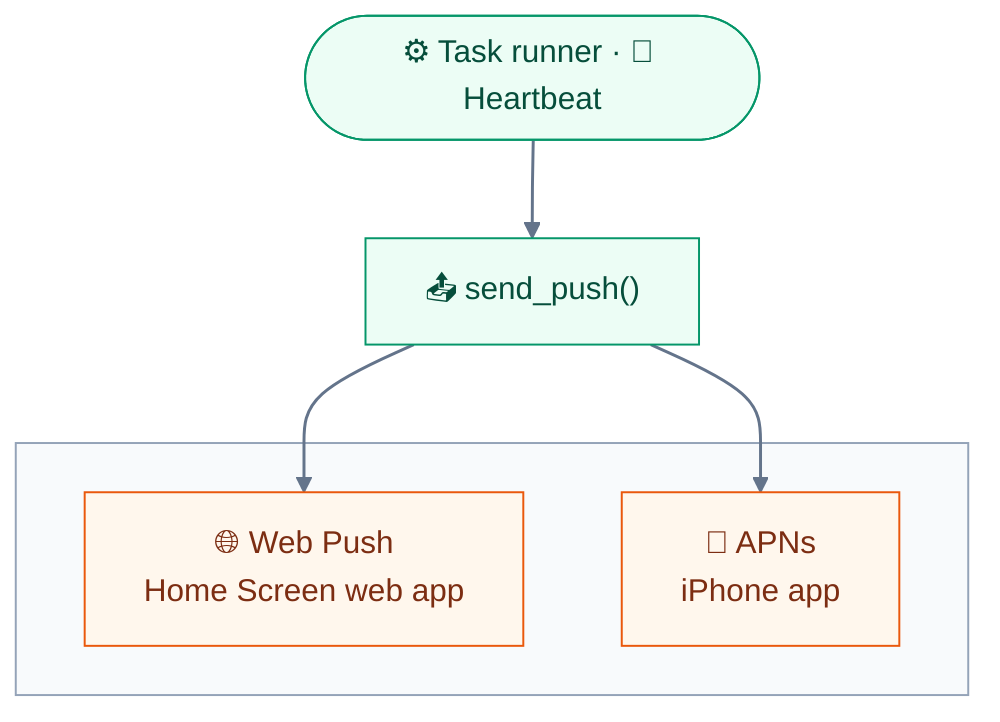

<div align="center">


# 🔔 Push hook

**The jarvis server's side of iPhone notifications: one patch that sends JARVIS's alerts to the app through APNs.**

[🏠 Home](../README.md) · [🧱 Architecture](../docs/architecture.md) · [🍎 iOS](../docs/ios.md) · [🤖 Android](../docs/android.md) · [🔨 Build & test](../docs/build.md) · [📲 Install](../docs/install.md) · [🔗 JARVIS side](../docs/jarvis-side.md) · [🌐 Web hook](../web-hook/README.md) · **🔔 Push hook**

</div>

---

The app registers with **Apple's push service (APNs)** itself, because its web view has no Web Push. When a voice
session starts it posts its device token to **`/api/push/native`** on the Mac.

**`jarvis-native-push.patch`** adds that endpoint to the jarvis repo, and makes **`send_push()`** send to the app
through APNs **as well as** to the Web Push subscriptions. The task runner and the heartbeat already call
`send_push()` for tasks that finish, fail or have a question, and for heartbeat alerts.



Android alerts go through FCM, which is already in the jarvis repo: see
[📲 Install → Android notifications](../docs/install.md#-android-notifications-firebase).

## 🧩 What the patch changes

| File | Change |
|---|---|
| `jarvis/apns.py` (new) | App devices, the provider token, and sending over HTTP/2 |
| `jarvis/config.py` | `APNS_KEY_FILE`, `JARVIS_APNS_KEY_ID`, `JARVIS_APNS_TEAM_ID`, `PUSH_DEVICES_FILE` |
| `jarvis/push.py` | `send_push()` sends Web Push and APNs together |
| `jarvis/web.py` | `POST /api/push/native` |
| `tests/test_apns.py` (new), `tests/test_push.py` | 19 new tests |
| `web/src/state/push.ts` | In the app, the notifications message says the app sets them up itself |

**`jarvis/apns.py`**

- **App devices** live in `data/push_devices.json` (mode 600), one per token.
- **The provider token** is an ES256 JWT signed with the APNs auth key, **reused for 50 minutes**.
- **Sending** goes over HTTP/2 to `api.sandbox.push.apple.com` (builds Xcode installs) or `api.push.apple.com`
  (TestFlight, App Store).
- A 410, `BadDeviceToken`, `Unregistered` or `DeviceTokenNotForTopic` **drops the device**.
- **Tokens never reach the log.**

**`jarvis/config.py`** — `APNS_KEY_FILE` defaults to `secrets/apns_key.p8`.

**`jarvis/push.py`** — one channel failing doesn't stop the other.

**`jarvis/web.py`** — `POST /api/push/native`:

| Request | Reply |
|---|---|
| `{"passcode", "device", "token", "environment", "topic"}` | `{"ok": true, "sending": bool}` |

| Status | When |
|:-:|---|
| **401** | Wrong passcode (it counts towards the lockout) |
| **400** | Malformed token |
| **409** | `JARVIS_PUSH` is off |

- The token is **kept even before APNs is set up**, with `sending: false` and a line in `logs/web.log` saying what's
  missing.

**Tests** — the Web Push tests keep their app devices in a temporary folder.

## 📦 The payload

```text
{"aps": {"alert": {"title", "body"}, "sound": "default", "thread-id": tag}, "url", "tag"}
```

- **`apns-collapse-id`** is set to the tag, so a newer push about the same task **replaces the older one**, as on Web
  Push.
- The app opens **`url`** (such as `/?task=3#title=…&body=…`) on the saved server when the notification is tapped.

## 🚀 Setting it up

> [!IMPORTANT]
> Needs a **paid Apple developer team**: a Personal Team can't sign push.

**1. Create an APNs auth key** — once, at developer.apple.com → Certificates, IDs & Profiles → Keys → **+**:

- Name it JARVIS and tick **Apple Push Notifications service (APNs)**.
- Configure → environment **Sandbox & Production**, then Continue and Register.
- Note the **Key ID** on that page, and the **Team ID** under Membership details.

> [!WARNING]
> You get **one chance to Download** the key. Do it before leaving the page.

**2. Put the key in place** — in the jarvis repo, next to this one:

```sh
cd ../jarvis
mv ~/Downloads/AuthKey_*.p8 secrets/apns_key.p8 && chmod 600 secrets/apns_key.p8
```

Then add to `.env` (`JARVIS_PUSH=on` should already be there, since the Home Screen web app gets pushes):

```sh
JARVIS_APNS_KEY_ID=<Key ID>
JARVIS_APNS_TEAM_ID=<Team ID>
```

**3. Apply, test, restart** — `sh ../jarvis-app/scripts/check-server-patch.sh` does a dry run first, on a copy:

```sh
git apply ../jarvis-app/server-hook/jarvis-native-push.patch
uv add 'httpx[http2]'      # APNs only speaks HTTP/2; this adds h2 to pyproject.toml and uv.lock
make test
make services-restart      # rebuilds the page and restarts the web app and the task runner
```

## ✅ Check it end to end

| | Where | What to look for |
|:-:|---|---|
| 📱 | The app | Start a session and allow notifications when iOS asks |
| ✅ | `logs/web.log` | `app push token saved for iphone (development)` |
| 🔔 | The phone, app closed | Any finished background task, or a heartbeat alert |
| ❌ | `logs/tasks.log` | `APNs push to iphone … failed` |

---

<div align="center">

[← 🌐 Web hook](../web-hook/README.md) &nbsp;·&nbsp; [🏠 Home →](../README.md)

</div>
